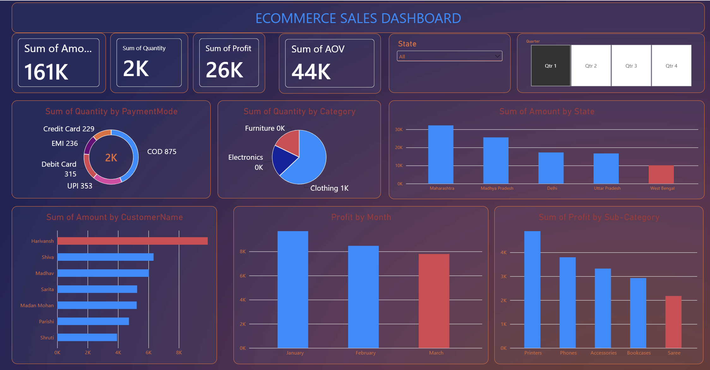

# E-Commerce Sales Dashboard & Business Analysis

## Project Overview
Developed an interactive dashboard to track, analyze, and visualize online sales data. The project focuses on exploring sales performance, customer behavior, product categories, payment methods, and profitability through interactive visualizations.

##📊 Dashboard Preview

## Tools & Technologies
- Microsoft Power BI
- Data Modeling
- Data Transformation
- Data Visualization

## Project Learnings & Implementation

- Created an interactive dashboard to track and analyze online sales data.
- Used parameters, filters, and slicers to drill down into data and customize analysis.
- Established data connections, joined multiple tables, and performed calculations to manipulate data and support dynamic visualizations.
- Developed customized visualizations to present business insights effectively.

## Visualizations Used
- Bar Chart
- Pie Chart
- Donut Chart
- Clustered Bar Chart
- Scatter Chart
- Line Chart
- Area Chart
- Map
- Interactive Slicers

## Dashboard Analysis
The dashboard provides insights into:

- Sales and quantity performance.
- Profitability across different months.
- State-wise sales distribution.
- Customer-wise sales performance.
- Product category and sub-category analysis.
- Payment mode distribution.

## Key Objectives
- Monitor overall e-commerce sales performance.
- Identify top-performing products and regions.
- Analyze customer purchasing patterns.
- Understand payment preferences.
- Evaluate profitability trends.
- Support data-driven business decisions.

## Repository Contents
- Power BI Dashboard (.pbix)
- Dashboard Screenshots

## Author
**Tinku Kumar**
